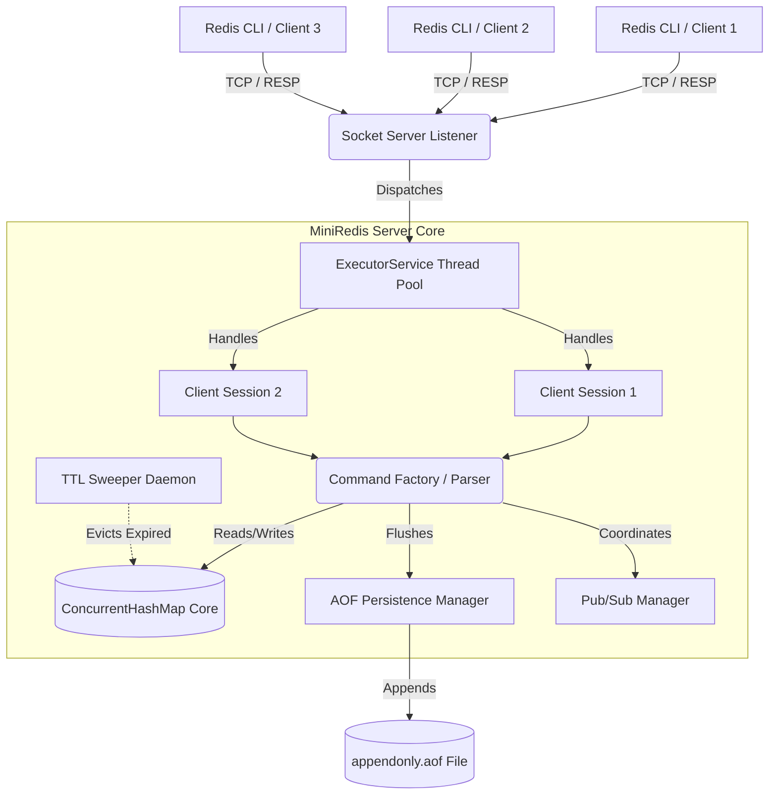

# System Design: MiniRedis

This document outlines the architectural decisions, internal components, and data structures used to build MiniRedis. The goal of this project was to implement a high-throughput, thread-safe, in-memory key-value database from scratch in Java, mimicking the core behaviors of Redis.

---

## 1. High-Level Architecture

MiniRedis is designed around a multi-threaded TCP server architecture. Unlike standard Redis, which is strictly single-threaded, MiniRedis leverages Java's robust concurrency primitives (`ExecutorService`, `ConcurrentHashMap`, `ReentrantLock`) to process non-conflicting commands concurrently.

---

## 2. Core Components

### 2.1 The TCP Server (`RedisServer` & `ClientHandler`)
- **Socket Listener:** A `ServerSocket` listens on port `6379`.
- **Thread Pool:** When a client connects, the socket is handed off to a `FixedThreadPool`. This allows multiple clients to send commands simultaneously without blocking the main server thread.
- **ClientSession:** Wraps the socket's `PrintWriter` and maintains state for that specific connection (e.g., whether the client is inside a `MULTI` transaction or is blocking on a `SUBSCRIBE` command).

### 2.2 RESP Protocol Parser (`CommandFactory`)
- MiniRedis speaks the **Redis Serialization Protocol (RESP)**. 
- The `CommandFactory` tokenizes incoming raw bytes (handling quoted strings properly) and routes them to the appropriate `Command` implementation.
- All outputs are formatted strictly as RESP Simple Strings (`+OK\r\n`), Bulk Strings (`$5\r\nhello\r\n`), Errors (`-ERR\r\n`), or Integers (`:1\r\n`).

### 2.3 The Storage Engine (`KeyValueStore`)
- **Data Structure:** Built on top of `ConcurrentHashMap<String, RedisValue>` to allow extremely fast, lock-free concurrent reads.
- **Eviction Policy:** Implements an $O(1)$ **Least Recently Used (LRU)** eviction policy.
  - To prevent memory exhaustion, memory usage is tracked in real-time. 
  - If the configured `maxMemoryBytes` is breached, the `LRUEvictionManager` kicks in.
  - It maintains a Doubly Linked List alongside a custom `HashMap` to track the usage order of keys, safely evicting the oldest accessed data in constant $O(1)$ time.

---

## 3. Advanced Subsystems

### 3.1 Persistence (Append-Only File)
Standard in-memory caches lose all data on restart. MiniRedis implements AOF to ensure durability.
- **Write Path:** Every mutating command (e.g., `SET`, `DEL`) is synchronously appended to `appendonly.aof` on disk immediately after execution.
- **Recovery Path:** On startup, the server reads the AOF file line-by-line and feeds the commands back through the `CommandFactory` to perfectly reconstruct the database state.
- **Compaction:** The `SAVE` command rewrites the AOF file by iterating through the current state of the `KeyValueStore` and writing a fresh, compacted sequence of `SET` commands, discarding old/deleted history.

### 3.2 Time-To-Live (TTL) Expiration
Implements the exact dual-strategy expiration used by real Redis:
1. **Lazy Expiration:** When a `GET` request comes in, the store checks the key's TTL. If expired, it is instantly deleted and returns `nil`.
2. **Active Sweeping:** A background `ScheduledExecutorService` thread wakes up periodically to sample random keys with TTLs and purge them, ensuring memory isn't wasted by keys that are never read again.

### 3.3 Atomic Transactions (`MULTI` / `EXEC`)
- When a client issues `MULTI`, their `ClientSession` flags itself as being in a transaction and begins queueing commands locally (returning `+QUEUED`).
- When `EXEC` is called, the server acquires a `ReentrantLock` (the `globalTransactionLock`). 
- It then executes the client's entire queue sequentially. Because of the global lock, no other threads can mutate the database during this batch execution, ensuring **strict isolation and atomicity**.

### 3.4 Pub/Sub Messaging
- Implements the **Observer Design Pattern**.
- `PubSubManager` maintains a mapping of `Channel Name -> Set<ClientSession>`.
- When a client issues `SUBSCRIBE`, they are added to the Set and their session enters a blocking mode.
- When `PUBLISH` is called, the manager iterates over the `Set` and asynchronously pushes the payload directly into the open `PrintWriter` streams of the subscribers.