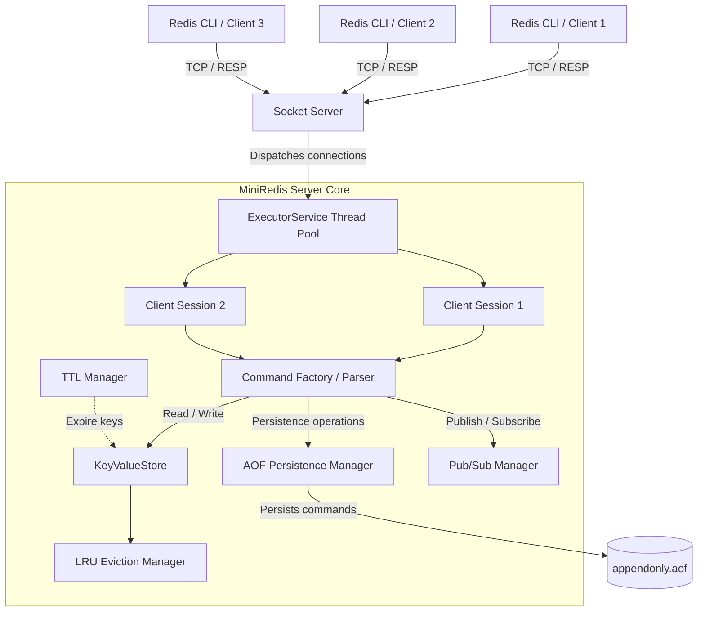

# MiniRedis 🚀

MiniRedis is a Redis-inspired, multithreaded, in-memory key-value database built from scratch using Java 21.

It implements the **Redis Serialization Protocol (RESP)** to enable interaction through compatible clients such as `redis-cli` for supported commands. The project explores core systems concepts, including concurrent client handling, thread-safe data storage, LRU eviction, TTL-based expiration, Append-Only File (AOF) persistence, transactions, and Pub/Sub messaging.

Built to deepen understanding of **backend engineering, concurrency, and database internals**, MiniRedis demonstrates how key-value storage and essential database features can be implemented using Java's concurrency primitives and networking APIs.


---

## High-Level Architecture

MiniRedis is built around a multithreaded TCP server that uses Java concurrency primitives such as ExecutorService, ConcurrentHashMap, and ReentrantLock to handle client connections and coordinate shared state.

Unlike Redis's traditional command-execution model, MiniRedis is designed to handle multiple client connections using a thread pool. Thread safety and command-level behavior depend on the synchronization implemented in each component.



### Core Components

- **Socket Server:** Accepts incoming TCP client connections and dispatches them to worker threads.
- **CommandFactory:** Parses and dispatches supported commands.
- **ClientSession:** Maintains client-specific state, including transaction and Pub/Sub state.
- **KeyValueStore:** Manages in-memory key-value operations.
- **LRUEvictionManager:** Tracks key usage and manages least-recently-used (LRU) eviction.
- **AofPersistenceManager:** Records supported mutating commands and restores persisted data during startup.
- **TTLManager:** Manages key expiration using the implemented expiration mechanisms.
- **PubSubManager:** Coordinates subscriptions and message delivery across connected clients.


---

## ⚡ Features

- **Concurrent In-Memory Storage:** Core storage engine powered by `ConcurrentHashMap`, enabling thread-safe key-value operations and concurrent access from multiple client connections.
- **TCP Socket Server:** Custom multithreaded networking layer using Java sockets and `ExecutorService` to handle concurrent client connections.
- **O(1) LRU Eviction:** Implements Least Recently Used eviction using a custom `HashMap` paired with a doubly linked list, enabling constant-time lookups, access-order updates, and eviction.
- **AOF Persistence:** Append-Only File (AOF) engine records mutating commands and replays persisted operations during server startup to restore data after a restart. Supports AOF log compaction to reduce persistence-file size.
- **Background Expiration (TTL):** Implements dual-strategy key expiration:
  - *Lazy Expiration:* Checks whether keys have expired when they are accessed.
  - *Active Sweeper:* Uses a background daemon task powered by `ScheduledExecutorService` to periodically remove expired keys.
- **Atomic Transactions (`MULTI`/`EXEC`):** Queues commands for transactional execution and uses a synchronization mechanism to prevent interleaving by other clients during transaction execution.
- **Real-Time Pub/Sub:** Implements channel-based publish/subscribe messaging, allowing messages to be broadcast to subscribed clients over open TCP socket connections.
-  **Automated Testing (JUnit 5):** Includes 21 passing tests covering command parsing, key-value storage, LRU eviction, TTL expiration, AOF persistence, transactions, Pub/Sub messaging, and concurrent access.
---

## 🛠️ Tech Stack

* **Language:** Java 21
* **Build Tool:** Maven
* **Core APIs used:** `java.net.Socket`, `java.util.concurrent`, `ReentrantLock`, `AtomicLong`, `LongAdder`
* **Testing:** JUnit 5

---

## 🚀 Getting Started

### Prerequisites
* Java 21 or later
* Maven 3.8+
* Redis CLI (redis-cli) — optional, for interactive testing

### Installation & Build
Clone the repository and build the project using Maven:

```bash
git clone https://github.com/shubham11045/MiniRedis.git
cd miniredis
mvn clean package
```

### Run the Server
Start MiniRedis:
```bash
java -jar target/mini-redis-1.0-SNAPSHOT.jar
```
By default, the server listens on port 6379. Confirm the startup message in the terminal before connecting
### Run Tests
Execute the automated test suite:
```bash
mvn test
```
To run the full Maven verification lifecycle, including tests and configured verification checks:
```bash
mvn clean verify
```
---

## 💻 Usage & Commands

MiniRedis implements the Redis Serialization Protocol (RESP) for client-server communication. You can test it using redis-cli for the commands and protocol features supported by this implementation.

Connect from another terminal:
```bash
redis-cli -h 127.0.0.1 -p 6379
```

### Basic Commands
```text
127.0.0.1:6379> SET user_id "Hruday" EX 60
OK
127.0.0.1:6379> GET user_id
"Hruday"
127.0.0.1:6379> EXISTS user_id
(integer) 1
127.0.0.1:6379> TTL user_id
(integer) 56
```
Note: TTL values decrease with time, so the exact result will vary.
### Transactions
```text
127.0.0.1:6379> MULTI
OK
127.0.0.1:6379> SET a 1
QUEUED
127.0.0.1:6379> SET b 2
QUEUED
127.0.0.1:6379> EXEC
1) OK
2) OK
```

### Pub/Sub Messaging
Use two client terminals connected to the same MiniRedis server.
***Terminal 1 (Subscriber):**
```text
127.0.0.1:6379> SUBSCRIBE alerts
Reading messages... (press Ctrl-C to quit)
1) "subscribe"
2) "alerts"
3) (integer) 1
```
Keep this client connected and subscribed to the alerts channel.
***Terminal 2 (Publisher):**
```text
127.0.0.1:6379> PUBLISH alerts "Hello World!"
(integer) 1
```
The subscriber should receive the published message. Exact output formatting depends on the client's handling of the RESP response.
---

## 🧪 Test Coverage

MiniRedis includes automated tests using **JUnit 5** to validate core functionality and reliability.

| Component | Coverage |
|---|---|
| Command Parsing | Supported command parsing and validation |
| Key-Value Store | Basic storage and retrieval operations |
| LRU Eviction | Least Recently Used eviction behavior |
| TTL Manager | Key expiration behavior |
| AOF Persistence | Data recovery after server restart |
| Transactions | `MULTI` / `EXEC` behavior |
| Pub/Sub | Message publishing and subscription |
| Concurrent Access | Behavior under concurrent operations |

### Run Tests

```bash
mvn test
```

Run the full Maven verification lifecycle:

```bash
mvn clean verify
```

---

## 🤝 Contributing
Contributions, bug reports, and feature requests are welcome. Please open an issue to discuss significant changes before submitting a pull request.
## 👨‍💻 Creator

**Shubham Gupta**  
B.E. Computer Science Engineering Student | Software Developer

Built MiniRedis to explore database internals, Java concurrency, networking, persistence, and distributed-systems concepts.

- GitHub: [@shubham11045](https://github.com/shubham11045)
- Project: [MiniRedis](https://github.com/shubham11045/mini-redis)


