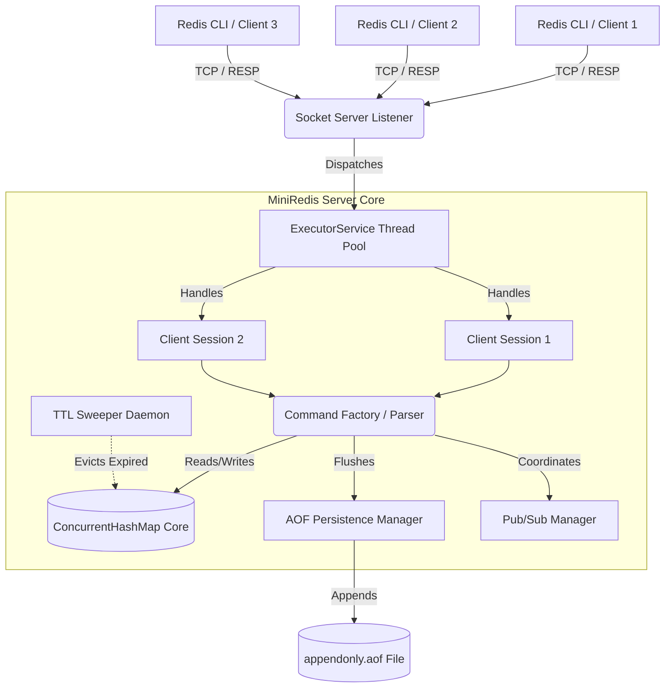

# MiniRedis 🚀

MiniRedis is a high-performance, multithreaded, in-memory key-value database written entirely in Java 21 from scratch. 

It is designed to be a lightweight clone of Redis, implementing the official **RESP (Redis Serialization Protocol)** so that it can be interacted with using standard industry tools like `redis-cli`. 

This project was built to deeply explore concurrency, system design, and low-level memory management without relying on heavy external frameworks.

---

## High-Level Architecture

MiniRedis is designed around a multi-threaded TCP server architecture. Unlike standard Redis, which is strictly single-threaded, MiniRedis leverages Java's robust concurrency primitives (`ExecutorService`, `ConcurrentHashMap`, `ReentrantLock`) to process non-conflicting commands concurrently.



---

## ⚡ Features

* **Lock-Free Reads (Concurrency):** Core storage engine powered by `ConcurrentHashMap`, achieving high throughput by allowing multiple clients to read concurrently.
* **TCP Socket Server:** Custom multithreaded networking layer using Java's `ExecutorService` to allocate dedicated threads to concurrent client connections.
* **O(1) LRU Eviction:** Strict memory bounding. When the configured memory limit is reached, it automatically evicts the Least Recently Used keys using a custom implementation of a `HashMap` paired with a Doubly Linked List.
* **AOF Persistence:** Fault tolerance via an Append-Only File engine. Mutating commands are synchronously flushed to disk and replayed perfectly upon server crash or restart to guarantee zero data loss.
* **Background Expiration (TTL):** Implements Redis's dual-strategy expiration:
  * *Lazy Expiration:* Keys are checked for expiration at read-time.
  * *Active Sweeper:* A daemon thread (`ScheduledExecutorService`) sweeps the database in the background to clean up abandoned keys.
* **Atomic Transactions (`MULTI`/`EXEC`):** Full support for queuing commands locally and executing them atomically inside a global transaction lock.
* **Real-time Pub/Sub:** Implements the Observer Pattern for high-speed message broadcasting directly over open TCP socket streams.

---

## 🛠️ Tech Stack

* **Language:** Java 21
* **Build Tool:** Maven
* **Core APIs used:** `java.net.Socket`, `java.util.concurrent`, `ReentrantLock`, `AtomicLong`, `LongAdder`
* **Testing:** JUnit 5

---

## 🚀 Getting Started

### Prerequisites
* Java 21 or higher
* Maven

### Installation & Build
Clone the repository and build the project using Maven:

```bash
git clone https://github.com/YOUR_USERNAME/miniredis.git
cd miniredis
mvn clean package
```

### Running the Server
Start the database server:
```bash
java -jar target/mini-redis-1.0-SNAPSHOT.jar
```
The server will start listening on port `6379`.

---

## 💻 Usage & Commands

Since MiniRedis implements the official **RESP protocol**, you can use the standard Redis CLI to connect to it!

Open a new terminal tab:
```bash
redis-cli -h 127.0.0.1 -p 6379
```

### Basic Commands
```text
127.0.0.1:6379> SET user_id "Hruday" EX 60
OK
127.0.0.1:6379> GET user_id
"Hruday"
127.0.0.1:6379> EXISTS user_id
(integer) 1
127.0.0.1:6379> TTL user_id
(integer) 56
```

### Transactions
```text
127.0.0.1:6379> MULTI
OK
127.0.0.1:6379> SET a 1
QUEUED
127.0.0.1:6379> SET b 2
QUEUED
127.0.0.1:6379> EXEC
1) OK
2) OK
```

### Pub/Sub Messaging
Open two terminals.
**Terminal 1 (Subscriber):**
```text
127.0.0.1:6379> SUBSCRIBE alerts
Reading messages... (press Ctrl-C to quit)
1) "subscribe"
2) "alerts"
3) (integer) 1
```
**Terminal 2 (Publisher):**
```text
127.0.0.1:6379> PUBLISH alerts "Hello World!"
(integer) 1
```

---

## 🏗️ Architecture overview

* `CommandFactory`: Tokenizes and dispatches incoming RESP commands.
* `ClientSession`: Manages individual TCP socket connections, handling isolated states like transaction queues and Pub/Sub blocking.
* `KeyValueStore`: The core memory engine handling `get/set` logic and enforcing LRU constraints.
* `AofPersistenceManager`: Handles file I/O for writing logs and replaying them on boot.
* `TTLManager`: Manages the background eviction lifecycle.

---

## 🤝 Contributing
Contributions, issues, and feature requests are welcome! Feel free to check the issues page.
